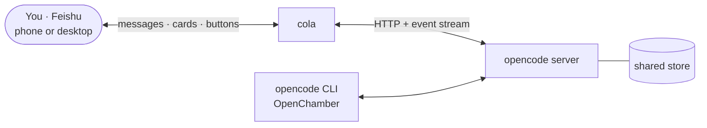

# cola

[](https://github.com/SXongin/cola/actions/workflows/ci.yml)
[](https://github.com/SXongin/cola/releases/latest)
[](https://crates.io/crates/colark)
[](https://codecov.io/gh/SXongin/cola)
[](https://securityscorecards.dev/viewer/?uri=github.com/SXongin/cola)
[](#1-install)
[](LICENSE)

**Your coding agent, in Feishu.** Send the bot a message from your phone — the AI
edits code on your machine, and you watch, steer and approve every step without
opening a terminal.

cola bridges [Feishu](https://www.feishu.cn) and [OpenCode](https://opencode.ai):
each DM is an OpenCode session, each turn streams onto one live card, and every
permission request becomes a button.

It is a bot for one person: you create the app, you claim it, and only you can
drive it.

*The name: **Co**de with **La**rk — Lark's China brand is Feishu.*

<!--
Hero media — drop the recorded GIF in and uncomment (see docs/images/README.md
for the shot list and naming). Keep the width so the card is legible on desktop
without dominating the page.
<p align="center">
  
</p>
-->

**中文文档**: [用户使用手册（简体中文）](docs/user-guide.zh-CN.md)。

## What it feels like

> **You** · 把 pollers 里那张卡的 chat 映射修一下
>
> **cola** · ⏳ 思考中 · `read pollers.rs` · `edit pollers.rs` · 14s
> ⚠️ 要运行 `cargo test` 吗？　**［允许］［总是允许］［拒绝］**
>
> **You** · （点「允许」）
>
> **cola** · ✅ 改完了 · 2 个文件 · **+18 −6**　**［🔍 查看完整改动］**

One card per turn, buttons for decisions, and `/cat` / `/diff` when you want to
read the code or the diff yourself. That is the whole surface.

## Try it

About **5 minutes**, and the Feishu side is free: you create a **self-built app**
(企业自建应用) for yourself (model usage bills to whatever provider your OpenCode
is configured with). You need:

- an `opencode` binary on `PATH` (see <https://opencode.ai>) — OpenCode
  **1.18.x (V1) and 2.0.x (V2) both work**; cola attaches to the shared server,
  starting one when none is running, and detects which protocol it speaks (the
  log records the choice)
- a Feishu account where you can create an app

### 1. Install

Download the archive for your platform from the [latest GitHub
release](https://github.com/SXongin/cola/releases/latest) and put the binary on
your `PATH` — **in a user-writable directory**. cola's self-update replaces its
own binary in place, which a root-owned path like `/usr/local/bin` would block:

| Platform | Release asset | Install to |
| --- | --- | --- |
| Linux x86_64 | `cola-<version>-x86_64-unknown-linux-gnu.tar.gz` | `~/.local/bin` |
| macOS (Apple Silicon) | `cola-<version>-aarch64-apple-darwin.tar.gz` | `~/.local/bin` |
| Windows x86_64 | `cola-<version>-x86_64-pc-windows-msvc.zip` | `%LOCALAPPDATA%\Programs\cola` |

- **macOS**: the binary is unsigned — clear the quarantine flag after
  extracting (`xattr -d com.apple.quarantine ~/.local/bin/cola`). There is no
  Intel build; Intel users must build from source.
- **Windows**: extract `cola.exe`, add the install directory to your user
  `PATH` (via the Environment Variables dialog), then reopen the terminal.
  `AppData\Local` is user-writable and not roamed, unlike `AppData\Roaming`.

Or install with Rust tooling: `cargo binstall colark` fetches the prebuilt
release asset (no compile), while `cargo install colark` (edition 2024) builds
from source — source builds need a C compiler and linker, plus NASM on Windows.
Updates follow the install channel: a cargo-tracked install is updated with
cargo (`/update` prints the command), an archive install uses cola's own
updater. Building from source is `cargo build --release`. The [user
guide](docs/user-guide.md#install) explains each choice in detail.

### 2. Create the Feishu app

One-time setup at <https://open.feishu.cn/app> (create a custom app). Do **not**
publish it yet — the event subscription in step 4 needs cola running first.

1. Enable the **bot capability** (应用能力 → 机器人) — required before the app can
   join chats or send anything.
2. Grant these three scopes (权限管理) and you are done:
   - `im:message` — send, reply to and update cards; read quotes and images
   - `im:message:send_as_bot` — send as the bot
   - `im:message.p2p_msg:readonly` — receive DMs

   Real names and the optional Instant Reminder each need one more scope — see
   below.

<details>
<summary>Optional extras: names and Instant Reminder</summary>

| Scope | What cola uses it for | If missing |
| --- | --- | --- |
| `im:message` | send/reply to and update cards; read a message by id (quote context); download message images | cola cannot reply or update cards — unusable |
| `im:message:send_as_bot` | send and reply to messages as the bot | card sending fails |
| `im:message.p2p_msg:readonly` | receive DMs | DMs never reach cola |
| `im:chat:readonly` | chat display names (`/attach` rejection card, `/switch` cards) | raw chat ids instead of names |
| `contact:contact.base:readonly` | authorizes the contact API call | user names unavailable |
| `contact:user.base:readonly` | returns the user's `name` field | completion notices lose the @name |
| `im:datasync.feed_card.time_sensitive:write` | *(optional)* Feishu Instant Reminder — pin a chat while a permission or question waits (`[bridge] instant_reminder`, off by default) | pinning is skipped, everything else works |

Missing scopes degrade features instead of crashing cola. The [user
guide](docs/user-guide.md#feishu-app-setup) maps every scope to what it unlocks.

</details>

### 3. Configure

Write `~/.cola/cola.toml` (or `./cola.toml` in the directory you run from, or
point explicitly with `cola --config <path>`):

```toml
[feishu]
app_id = "cli_xxxxxxxxxxxx"
app_secret = "your-app-secret"
```

That is the minimum. Everything else is optional — for example
`[bridge] instant_reminder = true` pins a chat while a permission waits, and
`[bridge] long_task_notice = true` announces a p2p turn that ran 5+ minutes with
a reply message (the card patch itself pushes no notification). See the [user
guide](docs/user-guide.md#configuration).

### 4. Start cola, then finish the app

```bash
cola
```

Leave it running (Ctrl-C stops it). Now, back in the developer console:

1. **事件与回调**: choose **使用长连接接收事件** (long-connection mode) and
   subscribe to `im.message.receive_v1`. This is why cola is running already —
   Feishu only accepts long-connection mode while a client is connected. Card
   buttons (`card.action.trigger`) arrive over the same connection; there is no
   webhook URL to configure.
2. **Publish** the version (版本管理与发布) so the scopes and events take effect.
3. DM the bot — that is the whole setup.

### 5. Claim the bot

cola is **private by default**: a fresh (or upgraded) instance starts
*unclaimed* and refuses everyone. On startup it prints a one-time **claim code**
(also in `~/.cola/cola.log`); DM the bot `/claim <code>` from your own Feishu
account to become its Host. After that only you can use it.

The code rotates on every restart, is never written to disk, and the claim
itself is one-time — restarts and upgrades never ask again. DM the bot `/help`
to see every command.

Inspect and control it from the shell: `cola status` (run state, autostart,
claim, server + generation; `--json` for scripts), `cola doctor` (the
environment checks a support request needs), `cola logs [-f]`, `cola restart`,
`cola config path|show|validate`, and `cola completions <shell>`.

### 6. Keep it running

Stop the foreground instance (Ctrl-C) and register cola to start at boot:

```bash
cola autostart enable
cola autostart status   # confirm it is registered
```

Two instances cannot share the bot — cola takes a singleton lock — so stop this
one first. macOS starts the supervised instance immediately; on Linux the unit
is only enabled, so `systemctl --user start cola` hands over now (otherwise it
comes up at your next login), and a headless machine also needs
`loginctl enable-linger $USER`. **Windows** uses an `HKCU\...\Run` value, which
takes effect at the next sign-in.

`cola autostart disable` stops the instance and removes the registration;
`cola stop` stops it but keeps it. Enable it **after** installing both cola and
`opencode` — the registration snapshots the binary path and your `PATH`, so
re-run `enable` if you move either. To detach from the terminal instead:
`nohup cola >/dev/null 2>&1 &` on Linux/macOS, or `start /b cola` on Windows.

## What you get

- **One card per turn, updated live.** Reasoning, tool calls and the answer
  stream onto a single card with collapsible panels, a phase timer and a live
  todo panel, so a slow turn never looks like a dead one; images in a message or
  a quoted reply ride along for vision-capable models.
- **Decisions are two taps.** Permission requests render as
  Allow / Deny / Always buttons on the card, and questions become a
  multi-select card that accepts custom answers.
- **See what changed, and read the code.** A finished turn with edits carries
  `N files · +A −D` and delivers the whole diff as one self-contained red/green
  HTML file — open it anywhere, nothing to install (OpenCode 2; V1 has no
  session diff). `/diff [--base <ref>]` does it for a branch, and `/cat <path>`
  previews any file on the host: paged, markdown/raw toggle, images and
  directory browsing, sendable as a file.
- **As many sessions as you have tasks.** `/new`, `/dir <path>`, `/switch` to
  adopt a session started elsewhere (with a snapshot of what is pending), `/sub`
  for the subagents a turn spawned. The store is shared with the CLI and
  OpenChamber, so a session begun anywhere continues here — and messages sent
  from another client come back into Feishu.
- **Set it and forget it.** Private by default, autostart at boot, a singleton
  lock, restart and self-update — on Linux, macOS and Windows.

## How it works



cola attaches to a running `opencode serve` on the shared store and starts one
when none is running. Because the store is shared, the same session can be
driven from Feishu, the CLI or OpenChamber — whichever you have at hand.

## Docs

- **User guide** — [docs/user-guide.md](docs/user-guide.md): where things live,
  full configuration reference, autostart, logs, self-update, singleton &
  restart, every Feishu command, troubleshooting.
- **用户使用手册（简体中文）** — [docs/user-guide.zh-CN.md](docs/user-guide.zh-CN.md):
  用户手册的简体中文译本（英文版为事实来源；结构漂移由
  `cargo xtask check-doc-drift` 守护）。
- **Contributing** — [CONTRIBUTING.md](CONTRIBUTING.md): commit conventions,
  the verification loop, PR rules.
- **Architecture** — [docs/adr/](docs/adr/), [GLOSSARY.md](GLOSSARY.md),
  [AGENTS.md](AGENTS.md) (includes the hard-won known pitfalls for the OpenCode
  server API and Feishu integration — read before contributing).
- **Code of conduct** — [CODE_OF_CONDUCT.md](CODE_OF_CONDUCT.md).

MIT licensed — see [LICENSE](LICENSE).
